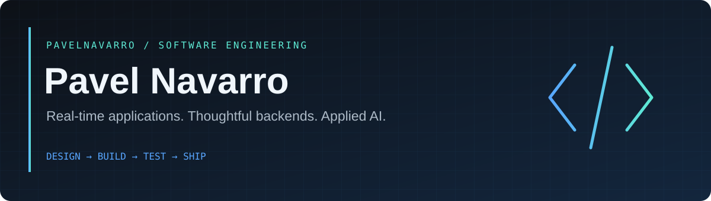

  

  
  
  

### Building the systems behind the experience.

I'm a **Computer Science student at UTEP**, with a minor in Mathematics. I build full-stack applications with a particular interest in what happens behind the interface: API design, real-time communication, data flow, and reliable application behavior.

My projects range from **competitive coding with live code execution** to **AI-assisted fitness tracking** and **shared expense management**. I've developed software through **Google Tech Exchange** and **SEO Tech Developer**, collaborating from initial design through deployment.

## Selected work

<table>
<tr>
<td width="50%" valign="top">
<h3>01 / Code Clash</h3>

<b>Competitive coding, in real time.</b>

Two-player coding matches with synchronized deadlines, server-side judging through Judge0, and reconnect recovery.

<code>React</code> <code>Node.js</code> <code>Socket.IO</code> <code>Judge0</code>

<b>Engineering focus:</b> authoritative match state, execution validation, and connection lifecycle.

<a href="https://github.com/pavelnavarro/Code-Clash"><b>Explore the code →</b></a>
</td>
<td width="50%" valign="top">
<h3>02 / FitTrack AI</h3>

<b>Turn workout data into useful feedback.</b>

Fitness tracking, progress projections, and Gemini-powered nutrition suggestions. Built with a team during Google Tech Exchange.

<code>Python</code> <code>Streamlit</code> <code>Vertex AI</code> <code>Cloud Run</code>

<b>Engineering focus:</b> AI integration, data visualization, and containerized cloud deployment.

<a href="https://github.com/pavelnavarro/workout-tracker"><b>Explore the code →</b></a>
</td>
</tr>
<tr>
<td width="50%" valign="top">
<h3>03 / Divy</h3>

<b>Shared expenses, simpler settlements.</b>

Personal and group expense tracking with splitting logic, authentication, Gemini assistance, and Google Calendar integration.

<code>Flask</code> <code>SQLAlchemy</code> <code>SQLite</code> <code>Gemini</code>

<b>Engineering focus:</b> backend APIs, persistence, and external service integration.

<a href="https://github.com/pavelnavarro/divy-expense-manager"><b>Explore the code →</b></a>
</td>
<td width="50%" valign="top">
<h3>04 / Good Deeds</h3>

<b>Make community service easier to track.</b>

A community service application for registering for events, tracking volunteer hours, and generating certificates.

<code>React</code> <code>Firebase</code> <code>JavaScript</code>

<b>Engineering focus:</b> user workflows and progress tracking.

<a href="https://github.com/pavelnavarro/Good-Deeds---Community-Service-Tracker-App"><b>Explore the code →</b></a>
</td>
</tr>
</table>

## Toolbox

| Layer | Technologies |
| :--- | :--- |
| **Languages** | Python · JavaScript · TypeScript · Java · SQL |
| **Frontend** | React · Next.js · HTML · CSS · Tailwind CSS |
| **Backend** | Node.js · Express · Flask · Socket.IO |
| **Data** | SQLite · SQLAlchemy · Firebase · Supabase |
| **Cloud & tooling** | Google Cloud · Docker · Git · GitHub Actions |
| **AI integrations** | Gemini · Vertex AI |

## Engineering interests

**Real-time systems** — keeping clients and server state in sync.  
**Backend design** — clear APIs, predictable data flow, and testable behavior.  
**Applied AI** — integrating models into useful software workflows.

---

From the interface to the API to the deployment.

